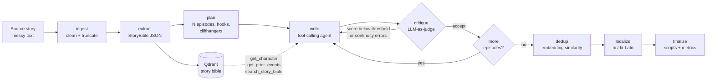

# StoryForge

**A LangGraph multi-agent pipeline that turns a public-domain story into a vertical microdrama series: episode scripts in English, Hindi and Hinglish, with hooks, cliffhangers, storyboard prompts and a quality score for every episode.**

[](https://github.com/rashikhadse/storyforge/actions/workflows/ci.yml)


> **Demo:** [huggingface.co/spaces/rashikhadse/storyforge](https://huggingface.co/spaces/rashikhadse/storyforge) · **Video walkthrough:** _add your Loom link_

Source text → story bible → series plan → episode scripts (writer ⇄ critic loop) → dedup → localization → Markdown scripts + `metrics.json`.

---

## Architecture



| Stage | What it does | Why it matters |
| --- | --- | --- |
| **ingest** | Strips Gutenberg/Wikisource boilerplate, HTML, page numbers and broken hyphenation; truncates to fit free-tier context | Real source text is messy |
| **extract** | Structured extraction into a Pydantic `StoryBible`: characters (with Devanagari names), locations, ordered plot beats, tone | One source of truth for every later stage |
| **index_bible** | Embeds every bible entry (multilingual MiniLM via FastEmbed) into Qdrant | Retrieval keeps long series consistent |
| **plan** | Splits beats into N episodes of 60–90 s; validated so every beat is used exactly once | Microdrama structure: hook in 5 s, cliffhanger at the end |
| **write** | Tool-calling agent: looks up characters and prior events in Qdrant, then writes scenes, dialogue and a 9:16 storyboard prompt per scene | Grounded generation instead of guessing |
| **critique** | LLM-as-judge on a 6-criterion rubric (hook, pacing, character consistency, dialogue, cliffhanger, faithfulness) + continuity check. Below threshold → back to the writer with notes | Evals feed back into the pipeline |
| **dedup** | Cosine similarity over embeddings: rewrites repeated hooks across episodes, drops lines a character repeats | Series feel less templated |
| **localize** | Hindi (Devanagari) and Hinglish dialogue with a name glossary; validated so every line id survives | Line ids let audio/subtitle tools map lines 1:1 |

### Reliability features

- **Schema-validated outputs with auto-repair.** Every LLM reply is parsed into a Pydantic model and then run through content checks, for example "speakers must exist in the bible" or "beats numbered 1..N". On failure, the exact validation errors go back to the model in a repair prompt (up to `MAX_REPAIR_ATTEMPTS`).
- **Retries with exponential backoff** on HTTP 429/5xx, which free tiers return often.
- **Provider-agnostic.** Groq, Gemini, OpenAI and a self-hosted vLLM server all use the same OpenAI-compatible client. The critic can run on a different provider than the writer, which avoids self-preference bias.
- **Tracing.** Every LLM call and node is logged to `trace.jsonl` with tokens, latency and cost. Set `LANGFUSE_*` keys to send the same traces to Langfuse.
- **Offline mock mode.** A deterministic fake LLM exercises every path (repair, tools, critic loop, dedup, localization), so tests and CI need no API key.

---

## Quickstart

```bash
git clone https://github.com/rashikhadse/storyforge && cd storyforge
python -m venv .venv && source .venv/bin/activate     # Windows: .venv\Scripts\activate
pip install -r requirements-dev.txt

# 1) Offline demo, no API key needed
python -m storyforge run data/stories/the_potters_daughter.txt --mock

# 2) Real run: free keys from console.groq.com and aistudio.google.com
cp .env.example .env        # then paste GROQ_API_KEY and GEMINI_API_KEY
python -m storyforge run data/stories/the_potters_daughter.txt --episodes 3 --languages hi,hi-Latn
```

Start with 3 episodes: a 5-episode run makes roughly 30 LLM calls, and free tiers cap tokens per day. Rate-limit errors (HTTP 429) are retried automatically with backoff.

Each run writes to `outputs/<run_id>/`:

```
story_bible.json   series_plan.json   episodes.json
script_en.md       script_hi.md       script_hi-Latn.md
metrics.json       trace.jsonl
```

### Use your own stories

Any public-domain text works, for example Premchand on Hindi Wikisource, or Panchatantra and Jataka translations on Project Gutenberg:

```bash
python -m storyforge fetch "<url of a Gutenberg .txt or Wikisource page>" data/stories/my_story.txt
python -m storyforge run data/stories/my_story.txt
```

### RAG ablation

```bash
python -m storyforge ablation data/stories/the_potters_daughter.txt --episodes 5
```

Runs the same story with story-bible retrieval on and off and compares continuity issues and judge scores (with RAG off, the writer sees only the outline and character names).

---

## API

```bash
uvicorn storyforge.api:app --reload --port 7860     # web demo at http://localhost:7860
```

| Method | Path | Description |
| --- | --- | --- |
| `POST` | `/generate` | `{"text": "...", "episodes": 5, "languages": ["hi"], "mock": false}` → `202 {"job_id": ...}` |
| `GET` | `/jobs/{id}` | Status (`queued`/`running`/`done`/`failed`), metrics, available scripts |
| `GET` | `/jobs/{id}/script?lang=en` | Script as Markdown (`en`, `hi`, `hi-Latn`, …) |
| `GET` | `/health` | Liveness + whether an LLM key is configured |

Interactive docs at `/docs`.

### Docker

```bash
docker build -t storyforge .
docker run -p 7860:7860 --env-file .env storyforge
```

Deploying to Hugging Face Spaces: see [`deploy/huggingface/README.md`](deploy/huggingface/README.md).

---

## Results

Measured on _N_ public-domain stories with `LLM_PROVIDER=groq` (Llama 3.3 70B) as writer and `CRITIC_PROVIDER=gemini` (Gemini 2.5 Flash) as judge. Every number comes from `metrics.json` and `ablation_rag.json`.

| Metric | Value | Source in `metrics.json` |
| --- | --- | --- |
| Schema-valid outputs, first pass → after repair | _X% → Y%_ | `structured_outputs.first_pass_valid_pct`, `valid_after_repair_pct` |
| Judge score, first draft → after critic loop (out of 5) | _X → Y_ | `quality.avg_first_draft_score`, `avg_final_score` |
| Continuity issues per episode, RAG off → on | _A → B_ | `ablation_rag.json` |
| Hooks rewritten / repeated lines removed by dedup | _X / Y_ | `dedup.*` |
| Cost per episode at list price | _$X_ | `cost_latency.cost_per_episode_usd` |
| LLM latency per episode | _X s_ | `cost_latency.total_llm_latency_s` ÷ episodes |

**Example output:** [`examples/`](examples/) _(commit one real run's `script_en.md` and `script_hi.md` here)_

---

## Project structure

```
storyforge/
├── pipeline.py      # LangGraph graph: nodes, routing, critic loop
├── llm.py           # OpenAI-compatible client: retries, structured output + repair, tool loop
├── schemas.py       # Pydantic contracts between stages
├── memory.py        # embeddings, Qdrant story bible, similarity/dedup
├── prompts/*.md     # one prompt per agent, versioned with the code
├── ingest.py        # cleaning messy source text, fetching stories
├── tracing.py       # trace.jsonl, metrics, optional Langfuse
├── render.py        # Markdown scripts
├── api.py           # FastAPI jobs API + static web demo
├── cli.py           # run / ablation / fetch
└── mock_llm.py      # deterministic offline LLM for tests and demos
tests/               # 27 tests, run offline in CI
data/stories/        # sample story (original, CC0)
```

## Configuration

All settings are environment variables; see [`.env.example`](.env.example). The most useful ones:

| Variable | Default | Meaning |
| --- | --- | --- |
| `LLM_PROVIDER` / `CRITIC_PROVIDER` | `groq` / same | `groq`, `gemini`, `openai`, `selfhosted`, `mock` |
| `<STAGE>_MODEL` | provider default | Per-stage model: `EXTRACT`, `PLAN`, `WRITE`, `CRITIQUE`, `DEDUP`, `LOCALIZE` (e.g. `DEDUP_MODEL=llama-3.1-8b-instant`) |
| `CRITIC_THRESHOLD` / `MAX_REVISIONS` | `3.8` / `2` | When the critic sends an episode back, and how often |
| `USE_RAG` | `true` | Story-bible retrieval for the writer |
| `DEDUP_THRESHOLD` | `0.90` | Cosine similarity above which two hooks/lines count as duplicates |
| `EMBED_MODEL` | `paraphrase-multilingual-MiniLM-L12-v2` | Any FastEmbed model, e.g. `intfloat/multilingual-e5-large` |
| `QDRANT_URL` | _(empty = in-memory)_ | Point at Qdrant Cloud to persist bibles |

## Roadmap

- **StoryEval:** a calibrated eval harness (judge vs human agreement, reference metrics, CI regression gate) to replace the built-in critic.
- **StoryServe:** run the writer on a self-hosted Llama 3.1 8B via vLLM (`LLM_PROVIDER=selfhosted`) and generate storyboard frames with FLUX.1 from each scene's `visual_prompt`.

## License

MIT. The bundled sample story is an original work released under CC0.
